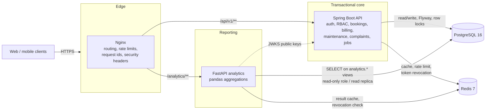
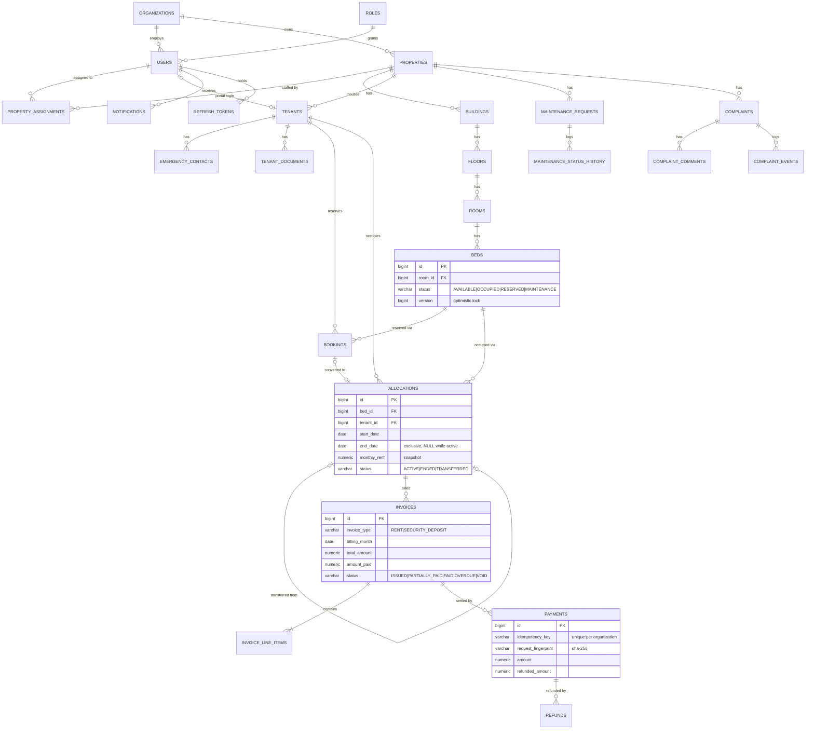
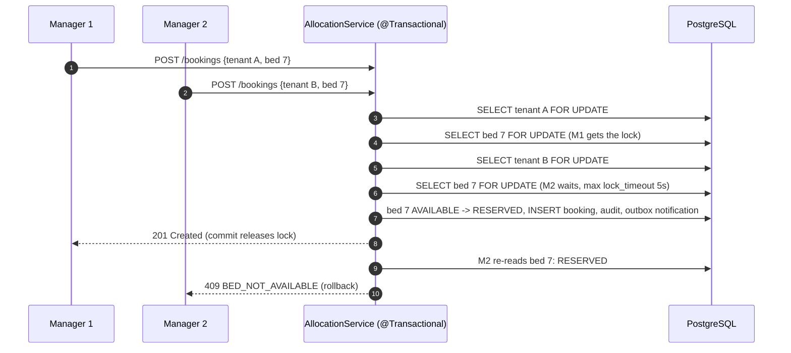
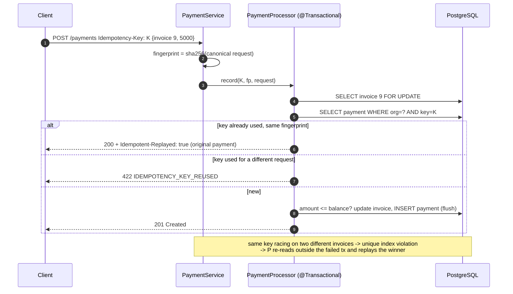
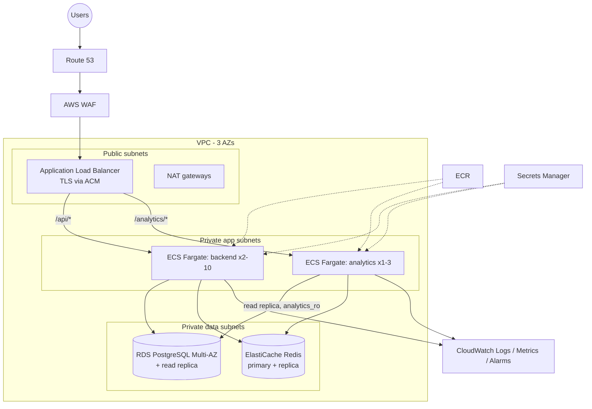

# PG Management & Operations Platform

A multi-tenant platform for running **PG (paying-guest) / co-living businesses** across many properties: beds and
occupancy, residents, reservations and check-ins, rent billing and payments, maintenance, complaints, notifications,
role-based dashboards and business analytics.

It is built as a realistic production-style backend:

* **Java 21 / Spring Boot 3.5** transactional core (PostgreSQL, Redis, RS256 JWT, Flyway, ShedLock)
* **Python 3.12 / FastAPI + pandas** analytics service that reads a published, read-only view schema
* **Nginx** edge proxy, **Docker Compose** for a one-command local environment
* **GitHub Actions** CI/CD with quality gates, image scanning and **AWS ECS Fargate** deployment

> Everything described here is implemented and tested unless it is explicitly listed under
> [Not implemented / limitations](#not-implemented--known-limitations).

---

## Contents

1. [Business problem](#business-problem)
2. [Architecture](#architecture)
3. [Technology stack and why](#technology-stack-and-why)
4. [Domain model (ER diagram)](#domain-model)
5. [Modules](#modules)
6. [API](#api)
7. [Security & authentication flow](#security--authentication-flow)
8. [Key workflows](#key-workflows)
9. [Running locally](#running-locally)
10. [Testing](#testing)
11. [CI/CD](#cicd)
12. [AWS deployment](#aws-deployment)
13. [Observability](#observability)
14. [Sample API requests](#sample-api-requests)
15. [Design decisions & trade-offs](#design-decisions--trade-offs)
16. [Not implemented / known limitations](#not-implemented--known-limitations)
17. [Future improvements](#future-improvements)

Further reading: [`docs/INTERVIEW_GUIDE.md`](docs/INTERVIEW_GUIDE.md) (design Q&A),
[`docs/AWS_DEPLOYMENT.md`](docs/AWS_DEPLOYMENT.md), [`docs/openapi.json`](docs/openapi.json),
[`analytics-service/README.md`](analytics-service/README.md) (metric definitions).

---

## Business problem

A PG operator typically runs several buildings with hundreds of beds. The day-to-day pain points are:

| Problem | What the platform does |
|---|---|
| Beds double-booked by two managers at the same time | Row-locked allocation workflow + PostgreSQL exclusion constraints make double allocation impossible |
| Rent tracked in spreadsheets, partial payments and late payers lost | Monthly rent invoices generated automatically (prorated on move-in), partial payments, overdue tracking, reminders, PDF receipts |
| Duplicate payment entries when a request is retried | Idempotent payment API (`Idempotency-Key`) |
| Deposits not reconciled at move-out | Check-out returns a settlement (deposit held − dues − deductions) and refunds are recorded idempotently |
| Maintenance requests and complaints forgotten | Ticket state machines, SLA deadlines, automatic SLA-breach flagging and complaint escalation |
| Owners lack visibility across properties | Role-specific dashboards and a separate analytics service (occupancy, revenue, collection, defaults, stay duration, SLA) |
| Many operators on one platform | Organization-level multi-tenancy with property-level access control |

---

## Architecture



**Request path.** Nginx assigns/propagates `X-Correlation-Id`, applies coarse per-IP limits and routes by path.
The backend validates the RS256 JWT, checks the role (`@PreAuthorize`) and then the *data scope*
(organization → property → own tenant record) in the service layer before touching data.

**Why two services.** The Spring Boot service owns every write and all business invariants. The analytics service is a
read-only consumer of a **versioned view contract** (`analytics.*`, migration `V2`) through a role that cannot see base
tables or PII. Heavy reporting queries can be pointed at a read replica and can never block or corrupt OLTP traffic.
The core has **no runtime dependency** on analytics: if it is down, only `/analytics/**` fails.

**Inside the backend** — package-by-feature, each feature layered `controller → service → repository/entity`:

```
com.pgms
├── auth          login, refresh-token rotation, logout, JWKS
├── user          users, roles, account activation
├── organization  tenancy boundary (PG operators)
├── property      property → building → floor, staff assignments, property cache
├── room          rooms, beds, bed state machine
├── tenant        residents, emergency contacts, KYC document metadata
├── booking       reservations, check-in/out, transfers, notice, expiry job
├── billing       invoices, line items, payments, refunds, receipts, billing jobs
├── maintenance   tickets, SLA, status history
├── complaint     complaints, comments, timeline, escalation job
├── notification  transactional outbox, dispatcher, channel senders
├── dashboard     role-specific KPIs (SQL aggregates, cached)
├── audit         append-only audit log
├── security      JWT, revocation, rate limiting, AccessGuard (data-level authorization)
├── common        error envelope, pagination, correlation ids, exceptions
└── config        security, cache, scheduling, OpenAPI, bootstrap
```

---

## Technology stack and why

| Technology | Purpose in this system |
|---|---|
| **Java 21, Spring Boot 3.5** | Transactional core. Mature transaction management, declarative security, first-class JPA, Actuator. |
| **Spring Data JPA / Hibernate** | Aggregates with optimistic locking (`@Version`), pessimistic row locks for contended rows, Specifications for filtering. |
| **PostgreSQL 16** | ACID, row-level locking, partial unique indexes, **exclusion constraints** (`btree_gist`) for date-range overlap, `pg_trgm` for name search, views for the analytics contract. |
| **Flyway** | Versioned, reviewable schema migrations; Hibernate only *validates* the schema. |
| **Spring Security + OAuth2 Resource Server (Nimbus)** | RS256 JWT issuance/validation, `@PreAuthorize` role checks. |
| **Redis 7** | Cache (property details, dashboard KPIs), auth rate limiting, access-token revocation markers, analytics result cache. Never the source of truth. |
| **ShedLock (JDBC)** | Runs each scheduled job on exactly one replica (rent generation, overdue marking, reservation expiry, SLA, escalation). Uses PostgreSQL so jobs keep working if Redis is down. |
| **OpenPDF** | Payment receipt PDFs. |
| **Micrometer + Prometheus registry, Actuator** | Health probes, JVM/HTTP/DB metrics, business counters. |
| **logstash-logback-encoder** | One JSON object per log line with correlation/user/org ids. |
| **Python 3.12, FastAPI, pandas, SQLAlchemy Core** | Analytics: time bucketing, interval expansion (bed-days), aging buckets, stay-chain merging are natural in pandas. |
| **Nginx** | Single entry point locally: path routing, per-IP limits, request ids, security headers, hides actuator. |
| **Docker / Compose** | Reproducible images (multi-stage, non-root), whole stack with one command. |
| **Testcontainers** | Integration tests against real PostgreSQL and Redis (locks and constraints cannot be tested on H2). |
| **GitHub Actions, Trivy, AWS ECS Fargate/ECR/RDS/ElastiCache/ALB** | CI/CD and production hosting (see [AWS](#aws-deployment)). |

---

## Domain model

Full DDL: [`V1__core_schema.sql`](backend/src/main/resources/db/migration/V1__core_schema.sql).
Analytics contract: [`V2__analytics_read_model.sql`](backend/src/main/resources/db/migration/V2__analytics_read_model.sql).



**Schema conventions:** identity PKs; FKs everywhere; enums as `VARCHAR` + `CHECK`; money `NUMERIC(12,2)`; timestamps
`TIMESTAMPTZ` (UTC) and business dates `DATE`; `created_*/updated_*` audit columns; `version` for optimistic locking on
contended aggregates; soft delete (`deleted_at` + partial unique indexes) for users, properties, rooms, beds and tenants.

**Invariants enforced by the database itself** (not only by code):

| Constraint | Guarantees |
|---|---|
| `ex_allocations_bed_overlap` `EXCLUDE USING gist (bed_id WITH =, daterange(start_date, end_date) WITH &&)` | No two stays on one bed ever overlap — including back-dated/historical rows |
| `ex_allocations_tenant_overlap` | A resident never occupies two beds at once |
| `uk_bookings_reserved_bed`, `uk_bookings_reserved_tenant` (partial unique) | One live reservation per bed and per tenant |
| `uk_invoices_rent_month` (partial unique) | At most one non-void rent invoice per allocation per month → billing job is idempotent |
| `uk_payments_idempotency (organization_id, idempotency_key)` | A payment request can only ever be applied once |
| `ck_invoices_paid`, `ck_invoices_totals`, `ck_payments_refunded` | `0 ≤ paid ≤ total`, `total = subtotal − discount`, `refunded ≤ amount` |

How "Rent" is modelled: the agreed rent is snapshotted on the **allocation**; monthly rent is billed as an
**invoice** of type `RENT` (with line items for extra charges and discounts). The deposit is a separate
`SECURITY_DEPOSIT` invoice. Revenue figures exclude deposits (they are a liability).

---

## Modules

| Module | Highlights |
|---|---|
| **Auth** | Login, RS256 access tokens (15 min), opaque rotating refresh tokens (14 days, SHA-256 hashed at rest, reuse detection), logout / logout-all, change password, JWKS endpoint, account activation/deactivation, Redis-backed login rate limit. |
| **Users & roles** | `SUPER_ADMIN`, `PROPERTY_ADMIN`, `MANAGER`, `STAFF`, `TENANT`. Admins manage accounts within their organization; managers/staff are assigned to properties. |
| **Properties** | Property → building → floor → room → bed hierarchy, status, address, rent due day, manager/staff assignment, live occupancy. |
| **Rooms & beds** | Room types with capacity rules, beds auto-generated from capacity, capacity changes (only free beds removed), bed state machine, maintenance toggling, availability search. |
| **Tenants** | Profile, emergency contacts, KYC document metadata (masked numbers only), status lifecycle, search (name/email/phone, `pg_trgm`), stay history, balance, portal login creation. |
| **Booking & allocation** | Time-boxed reservations with automatic expiry, check-in (reserved or walk-in), check-out with deposit settlement, transfers across rooms/properties, notice period, full allocation history. |
| **Billing** | Deposit + prorated first-month invoice at check-in, daily idempotent monthly rent generation, extra charges, discounts, void, overdue marking, due reminders, idempotent payments and refunds, PDF receipts, outstanding balance. |
| **Maintenance** | Tenant/staff-raised tickets, category & priority, assignment to assigned staff, state machine, mandatory resolution notes, priority-based SLA, automatic breach flagging, status history. |
| **Complaints** | Categories, priority, assignment, comments (internal staff-only notes hidden from tenants), resolution/reopen, manual and automatic escalation (3 levels), full timeline. |
| **Notifications** | Transactional outbox: rows written in the same DB transaction as the business change; IN_APP delivered immediately, EMAIL dispatched asynchronously with retry/backoff via a pluggable `NotificationSender`. |
| **Dashboard** | Operations KPIs for admins/managers (scoped), work queue for staff, dues/stay summary for tenants. |
| **Audit** | Append-only audit log (actor, action, entity, details JSON, IP, correlation id) written in the business transaction. |

---

## API

* Base path `/api/v1`, JSON, resource-oriented, ~100 operations across the resources listed below.
* Interactive docs: **Swagger UI** at `/swagger-ui.html`, spec at `/v3/api-docs` (snapshot: [`docs/openapi.json`](docs/openapi.json)).
  Disabled in the `prod` profile.
* **Pagination/sorting**: `?page=0&size=20&sort=createdAt,desc` (max size 100). Sort fields are **whitelisted** per
  resource; anything else → `400 INVALID_SORT`. Responses use a stable envelope:
  `{content, page, size, totalElements, totalPages, last}`.
* **Filtering** by query parameters (e.g. `/tenants?status=ACTIVE&q=meera&joinedFrom=2026-01-01`).
* **Idempotency**: `POST /payments` and `POST /payments/{id}/refunds` require `Idempotency-Key`.
  First call → `201`; identical retry → `200` + `Idempotent-Replayed: true`; same key, different body → `422`.

| Resource | Main operations |
|---|---|
| `/auth` | `POST login, refresh, logout, logout-all, change-password` · `GET me, jwks` |
| `/organizations` | CRUD + `PATCH /{id}/status` (SUPER_ADMIN) |
| `/users` | create, search, update, activate/deactivate, reset-password, soft delete |
| `/properties` | CRUD, status, `/{id}/occupancy`, `/{id}/buildings`, `/{id}/buildings/{b}/floors`, `/{id}/assignments` |
| `/rooms` | create (beds generated), search, update (pricing/layout), status, delete |
| `/beds` | availability search, get, `PATCH /{id}/status` (maintenance), `/{id}/allocations` |
| `/tenants` | create, search, get, update, delete, `/me`, emergency contacts, documents, portal account, `/{id}/allocations`, `/{id}/balance` |
| `/bookings` | reserve, search, get, cancel |
| `/allocations` | `check-in`, `/{id}/check-out`, `/{id}/transfer`, `/{id}/notice`, search |
| `/invoices` | search, get, `/{id}/charges`, `/{id}/discounts`, `/{id}/void`, `generate` |
| `/payments` | record (idempotent), search, get, `/{id}/receipt` (PDF), `/{id}/refunds` |
| `/maintenance` | create, search, get, assign, status, history |
| `/complaints` | create, search, get, assign, status, escalate, comments, history |
| `/notifications` | inbox, unread-count, mark read, read-all |
| `/dashboard` | role-specific dashboard |
| `/audit-logs` | search the audit trail (admins) |
| `/analytics/*` (Python) | `occupancy, revenue, payments, tenants, maintenance, complaints, properties` (+ `format=csv`) |

**Error envelope** (identical in both services):

```json
{
  "timestamp": "2026-10-05T19:10:43.537Z",
  "status": 409,
  "error": "Conflict",
  "code": "BED_NOT_AVAILABLE",
  "message": "Cannot reserve bed A: bed is RESERVED (expected AVAILABLE)",
  "path": "/api/v1/bookings",
  "correlationId": "15a0c716-86d3-4be6-b769-77c9168506f7",
  "fieldErrors": [{ "field": "phone", "message": "must be 10-15 digits" }]
}
```

Status codes: `400` validation/malformed, `401` unauthenticated/invalid token, `403` role or scope, `404` not found
(also used for resources in *another organization*, so existence is not disclosed), `409` state conflict or concurrent
modification, `422` business-rule violation, `429` rate limited, `500` unexpected (no internals leaked).

---

## Security & authentication flow

```mermaid
sequenceDiagram
    autonumber
    participant C as Client
    participant B as Backend
    participant DB as PostgreSQL
    participant R as Redis
    participant A as Analytics
    C->>B: POST /auth/login {email, password}
    B->>R: INCR rate-limit counter (per IP, fail-open)
    B->>DB: load user, bcrypt verify, check active + org not suspended
    B->>DB: store SHA-256(refresh token), family id
    B-->>C: access JWT (RS256, 15 min) + opaque refresh token (14 d)
    C->>B: GET /api/v1/... Authorization: Bearer JWT
    B->>B: verify signature, iss, aud, exp, token_type
    B->>R: revoked jti? tokens invalid-before for user?
    B->>B: @PreAuthorize role + AccessGuard data scope
    C->>A: GET /analytics/revenue Bearer JWT
    A->>B: GET /auth/jwks (cached)
    A->>R: same revocation check
    C->>B: POST /auth/refresh {refreshToken}
    B->>DB: SELECT ... FOR UPDATE token; rotate (old revoked, new issued)
    Note over B,DB: replay of a rotated token => revoke whole family<br/>+ invalidate all live access tokens of the user
```

* **Passwords**: bcrypt via `DelegatingPasswordEncoder` (algorithm-upgradable). Unknown e-mails are checked against a
  dummy hash so response time does not reveal which accounts exist. Password policy enforced by validation.
* **Tokens**: asymmetric RS256 — only the backend can mint tokens; other services verify with the public JWKS. Keys come
  from the environment (Secrets Manager in AWS); local dev may use an ephemeral pair.
* **Revocation**: logout blacklists the token `jti` in Redis until it would expire; deactivation, password change,
  logout-all and refresh-token reuse set a per-user *invalid-before* timestamp.
* **Authorization in two layers**: role checks with `@PreAuthorize`; data scope in `AccessGuard`
  (`SUPER_ADMIN` all, `PROPERTY_ADMIN` own organization, `MANAGER`/`STAFF` assigned properties, `TENANT` own records).
* **Input validation** with Bean Validation on every request DTO; sort whitelist; rejected values for password/token
  fields are never echoed back; strict correlation-id charset (no log injection).
* **Other**: stateless sessions (CSRF not applicable), CORS allow-list from env, CSP/frame/referrer headers, actuator
  limited to health/info/prometheus (nginx blocks `/actuator/**` publicly), non-root containers,
  least-privilege DB roles (`pgms_app` is not a superuser; `analytics_ro` can only read `analytics.*` views),
  **no secrets in Git** (`.env` is ignored; `.env.example` holds placeholders).

---

## Key workflows

### Reserve → check-in (concurrency-safe)



1. **Lock ordering** everywhere: tenant → booking → allocation → beds (ascending id). Opposite transfers therefore
   cannot deadlock (covered by `oppositeTransfersDoNotDeadlock`).
2. After locking, the **bed state machine** decides (`AVAILABLE → RESERVED → OCCUPIED → AVAILABLE`, `MAINTENANCE`).
3. Even if application code were bypassed, **exclusion constraints** reject overlapping stays.
4. Check-in in one transaction: bed `OCCUPIED`, allocation `ACTIVE` (rent/deposit snapshot), booking `CHECKED_IN`,
   tenant `ACTIVE`, deposit invoice + prorated first-month rent invoice, audit row, outbox notifications.
   Any failure rolls everything back (the concurrency test asserts no orphan invoices exist for losers).

### Monthly billing

`BillingJobs` runs daily (ShedLock): finds allocations that occupied a bed on the 1st without a live rent invoice and
generates one per allocation **in its own transaction**; the unique index `uk_invoices_rent_month` makes re-runs and
races harmless. Overdue marking and due-date reminders (deduplicated notifications) run on their own schedules.
A transfer mid-month keeps the month on the old allocation; the new rent applies from the next cycle.

### Idempotent payment



### Maintenance & complaints

Tickets follow explicit state machines (`OPEN → ASSIGNED → IN_PROGRESS → RESOLVED → CLOSED`, plus `CANCELLED` and
reopen). SLA deadline = created + priority target (CRITICAL 4 h, HIGH 24 h, MEDIUM 3 d, LOW 7 d); a job flags breaches
and notifies managers/admins. Complaints escalate (manually or automatically when overdue) up to level 3, each level
with a fresh deadline; tenants never see internal notes.

---

## Running locally

Prerequisites: Docker (Compose v2). For running services outside Docker: JDK 21+, Maven 3.9, Python 3.12.

```bash
cp .env.example .env            # then edit the placeholder passwords
docker compose up --build       # postgres, redis, backend, analytics, nginx
```

| URL (default ports) | |
|---|---|
| `http://localhost/api/v1/...` | API through nginx |
| `http://localhost/analytics/...` | analytics through nginx |
| `http://localhost/swagger-ui.html` | Swagger UI |
| `http://localhost/health` | readiness |

If ports 80/5432/6379/8080/8000 are taken, set `NGINX_HOST_PORT`, `POSTGRES_HOST_PORT`, … in `.env`.
After editing `infra/nginx/nginx.conf`, recreate the container (`docker compose up -d --force-recreate nginx`),
because a single-file bind mount keeps pointing at the old file.

**Demo data**: set `SPRING_PROFILES_ACTIVE=docker,demo` and `APP_DEMO_PASSWORD` in `.env`. The seeder creates an
organization with 3 properties, 90 beds and ~14 months of history (stays, invoices, on-time/late/missed payments,
deposit refunds, tickets, complaints). Logins (password = `APP_DEMO_PASSWORD`):
`owner@sunrise.example.com` (PROPERTY_ADMIN), `manager.blr@sunrise.example.com` (MANAGER),
`staff1@sunrise.example.com` (STAFF), `tenant.demo@example.com` (TENANT). The platform admin comes from
`APP_BOOTSTRAP_SUPER_ADMIN_EMAIL/PASSWORD`.

**Persistent JWT keys** (needed for more than one backend instance): `./scripts/generate-jwt-keys.sh >> .env`.

**Backend outside Docker** (with Compose's postgres/redis running):

```bash
cd backend
DB_URL=jdbc:postgresql://localhost:5432/pgms DB_USERNAME=pgms_app DB_PASSWORD=... \
REDIS_PASSWORD=... SPRING_PROFILES_ACTIVE=local mvn spring-boot:run
```

**Analytics outside Docker**: see [`analytics-service/README.md`](analytics-service/README.md#running-locally).

---

## Testing

| Suite | What it covers | Command |
|---|---|---|
| Backend unit (70) | Domain state machines (bed, invoice, payment, allocation, booking, maintenance, complaint, tenant), rent proration, access guard matrix, auth service (rotation, reuse detection, suspension), token revocation fail-open, payment idempotency race handling, PEM parsing | `mvn test` |
| Backend integration (31, Testcontainers PostgreSQL 16 + Redis 7) | Concurrent double-booking/check-in (8 racers → 1 winner, no orphan rows), deadlock-free opposite transfers, concurrent idempotent payments, overpayment race, refunds, full tenancy lifecycle, RBAC & cross-organization isolation, auth flows (rotation, reuse, logout revocation, deactivation), DB exclusion/check constraints, idempotent rent generation, maintenance/complaint workflows, PDF receipts, dashboards, notifications, administration | `mvn verify` |
| Analytics (161, 98% coverage) | Every metric on hand-built DataFrames incl. edge cases, API with fake repositories, JWT/JWKS/revocation/scoping security tests | `pytest --cov=app` |
| End-to-end smoke (38 checks) | The running Docker stack through nginx, both services | `BASE_URL=http://localhost ./scripts/smoke-test.sh` |

Quality gates: Checkstyle (fails the build), JaCoCo ≥ 75% line coverage (currently ~78%), ruff lint + format,
pytest coverage ≥ 90%.

---

## CI/CD

[`.github/workflows/ci-cd.yml`](.github/workflows/ci-cd.yml):

1. **backend** — checkout → JDK 21 → `mvn verify` (Checkstyle, unit tests, Testcontainers integration tests,
   JaCoCo gate) → upload reports.
2. **analytics** — Python 3.12 → `ruff check`, `ruff format --check` → `pytest --cov-fail-under=90`.
3. **images** — Buildx builds both images (layer cache), **Trivy** scan fails on fixable CRITICAL CVEs, pushes to
   **ECR** tagged with the commit SHA (main only).
4. **deploy** (main only, `production` environment with required reviewers) — renders ECS task definitions with the new
   images, deploys backend first (runs Flyway), then analytics, waits for service stability, then probes the public URL.

AWS access uses **GitHub OIDC** → IAM role (`AWS_DEPLOY_ROLE_ARN` secret); no static AWS keys exist in GitHub.

---

## AWS deployment

Summary (details, security groups and sizing in [`docs/AWS_DEPLOYMENT.md`](docs/AWS_DEPLOYMENT.md)):



ALB performs path routing and TLS termination (the role nginx plays locally); tasks run in private subnets; RDS and
ElastiCache are reachable only from the task security groups; secrets are injected by ECS from Secrets Manager.

---

## Observability

* **Structured logs**: JSON (logstash encoder) with `correlationId`, `userId`, `orgId` in every line; one access-log line
  per request (method, path, status, latency); errors logged once with stack trace, clients get only a correlation id.
* **Correlation ids**: accepted from `X-Correlation-Id` (generated by nginx otherwise), echoed in responses and error
  bodies, stored on audit rows.
* **Health**: `/actuator/health/liveness` and `/actuator/health/readiness` (readiness checks PostgreSQL only — Redis is
  optional by design); analytics `/health/live`, `/health/ready`.
* **Metrics**: `/actuator/prometheus` (JVM, HTTP request timings, Hikari pool, cache) plus business counters
  `pgms.bookings.reserved|expired`, `pgms.allocations.checked_in|checked_out|transferred`, `pgms.payments.recorded`
  (by method), `pgms.payments.amount`, `pgms.refunds.issued`.

---

## Sample API requests

```bash
BASE=http://localhost
TOKEN=$(curl -s -X POST $BASE/api/v1/auth/login -H 'Content-Type: application/json' \
  -d '{"email":"owner@sunrise.example.com","password":"Demo12345"}' | jq -r .accessToken)
AUTH="Authorization: Bearer $TOKEN"

# available AC double beds under 13,000 in a property
curl -s "$BASE/api/v1/beds?propertyId=1&status=AVAILABLE&roomType=DOUBLE&airConditioned=true&maxRent=13000" -H "$AUTH"

# register a resident
curl -s -X POST $BASE/api/v1/tenants -H "$AUTH" -H 'Content-Type: application/json' -d '{
  "propertyId": 1, "fullName": "Meera Iyer", "email": "meera@example.com", "phone": "+919812345670",
  "emergencyContacts": [{"name": "R Iyer", "relationship": "Father", "phone": "+919812345671", "primary": true}]}'

# reserve a bed for 48h, then check in against the reservation
curl -s -X POST $BASE/api/v1/bookings -H "$AUTH" -H 'Content-Type: application/json' \
  -d '{"tenantId": 205, "bedId": 17, "expectedCheckInDate": "2026-10-06"}'
curl -s -X POST $BASE/api/v1/allocations/check-in -H "$AUTH" -H 'Content-Type: application/json' \
  -d '{"tenantId": 205, "bookingId": 3, "checkInDate": "2026-10-06"}'

# record a payment (safe to retry with the same key)
curl -s -X POST $BASE/api/v1/payments -H "$AUTH" -H 'Content-Type: application/json' \
  -H "Idempotency-Key: $(uuidgen)" -d '{"invoiceId": 1520, "amount": 24000, "method": "UPI", "externalReference": "UPI-889210"}'

# check out with a deduction; response contains the deposit settlement
curl -s -X POST $BASE/api/v1/allocations/215/check-out -H "$AUTH" -H 'Content-Type: application/json' \
  -d '{"checkOutDate": "2026-10-06", "deductions": [{"description": "Broken chair", "amount": 1500}]}'

# dashboards & analytics
curl -s $BASE/api/v1/dashboard -H "$AUTH"
curl -s "$BASE/analytics/revenue?from=2026-01&to=2026-09" -H "$AUTH"
curl -s "$BASE/analytics/properties?sortBy=collectionRate&order=asc" -H "$AUTH"
curl -s "$BASE/analytics/payments?format=csv" -H "$AUTH" -o receivables.csv
```

Example (real output from the demo data) — `GET /api/v1/dashboard` as PROPERTY_ADMIN:

```json
{"scope":"org=1;props=*","activeTenants":69,
 "beds":{"total":90,"occupied":69,"available":18,"reserved":1,"maintenance":2,"occupancyRate":76.67},
 "monthlyRevenue":612866.67,"outstandingRent":828669.36,"overdueInvoices":83,"pendingMaintenance":5,
 "slaBreachedMaintenance":2,"openComplaints":1,"escalatedComplaints":1, "upcomingCheckouts":[...], "recentPayments":[...]}
```

---

## Design decisions & trade-offs

| Decision | Why | Trade-off |
|---|---|---|
| Modular monolith for the transactional core | All invariants (bed ↔ allocation ↔ invoice) commit in one ACID transaction; no distributed transactions | Modules share a database; boundaries are kept by packages and events, not process isolation |
| Separate analytics service on a view contract | Different workload and language strengths; isolates heavy reads; least-privilege DB role | Two deployables; analytics is eventually consistent with a read replica |
| Pessimistic row locks for allocation, optimistic `@Version` elsewhere | Bed contention is real and short; locks give deterministic "one winner" semantics; elsewhere conflicts are rare | Lock waits under contention (bounded by `lock_timeout=5s`) |
| DB constraints as the final guard | Correctness even with bugs, back-dated rows or manual SQL | Must translate constraint names to API errors (`ConstraintViolationTranslator`) |
| Idempotency stored on the payment row (`org + key + fingerprint`) | Atomic with the payment itself, durable, no extra store | Keys never expire (fine at this volume; a TTL/archival job would be added at scale) |
| Transactional outbox for notifications | A notification exists iff the business change committed; providers can be slow/flaky | At-least-once delivery for external channels |
| RS256 + JWKS instead of a shared HMAC secret | Other services verify without being able to mint tokens | Key management (rotation by publishing multiple JWKs is future work) |
| Redis is optional (fail-open) | Availability: an outage degrades caching, rate limiting and instant revocation but never blocks business operations | During a Redis outage a logged-out token stays valid ≤ 15 min (refresh tokens are still revoked in PostgreSQL) |
| ShedLock on PostgreSQL | Jobs run once per schedule across replicas and keep working without Redis | One more table; jobs are additionally idempotent so a double run is harmless anyway |
| IDENTITY primary keys | Simple, readable | Disables Hibernate JDBC insert batching; sequence + pooled optimizer would be chosen for bulk loads |
| Package-by-feature, explicit DTO mapping (records), no Lombok/MapStruct | Readable, no annotation magic, compiler-checked | More boilerplate |
| `@PreAuthorize` after body validation | Standard Spring MVC ordering | A caller without the role may see a `400` for a malformed body before a `403` (no data disclosed) |

More reasoning (concurrency, scaling to 10×, failure modes) in [`docs/INTERVIEW_GUIDE.md`](docs/INTERVIEW_GUIDE.md).

---

## Not implemented / known limitations

Being explicit about scope:

* **No real payment gateway**: payments are recorded by staff (cash/UPI/bank). The idempotent recording path is what a
  gateway webhook would call. No online tenant self-payment.
* **No real email/SMS/push provider**: EMAIL notifications go through `LoggingEmailSender` (logs instead of sending);
  SMS/PUSH are extension points (`NotificationSender`). In-app notifications are fully functional.
* **KYC documents**: metadata only (masked number, verification status, storage key); no file upload to S3.
* **Refunds do not reopen invoices**: they reduce net collected revenue (used for deposit returns). Reversing an
  erroneous rent payment (chargeback/reversal) is not modelled.
* **Deposit difference on transfer** (moving to a room with a higher deposit) is not billed automatically.
* **No late fees by default**: managers can add `LATE_FEE` charges manually; automatic late-fee rules are future work.
* **Infrastructure as code**: AWS is documented and the ECS task definitions + CI deploy are provided, but the VPC,
  RDS, ElastiCache and ALB are not provisioned by Terraform/CDK in this repository.
* No frontend; Swagger UI and the smoke script are the clients.
* Analytics: Excel export, scheduled reports, forecasting and anomaly detection are designed-for extension points only.

---

## Future improvements

* Terraform/CDK for the AWS stack; blue/green deployments with CodeDeploy.
* Payment gateway integration (webhooks into the idempotent path) and online rent payment for tenants.
* JWT key rotation (multiple keys in JWKS, `kid`-based selection), optional MFA for admins.
* Outbox relay to SNS/SQS (or Debezium CDC) for external integrations; real SES/SNS senders.
* Automatic late-fee policy per property, deposit top-up on transfer, payment reversals.
* PostgreSQL row-level security as a second tenancy safety net; table partitioning for `audit_logs`/`notifications`.
* Scheduled PDF/Excel reports and simple forecasting (seasonal occupancy) in the analytics service once enough history exists.
* OpenTelemetry tracing across nginx → backend → analytics.
