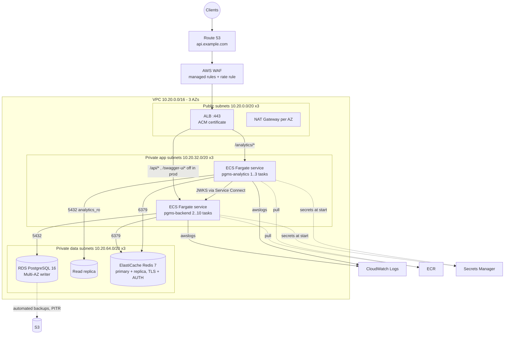

# AWS Deployment Architecture

Target: a production deployment in one region (e.g. `ap-south-1`, Mumbai) across three Availability Zones.

**What is in the repository:** container images and Dockerfiles, ECS task definition templates
(`infra/aws/ecs/*.json`), and the GitHub Actions pipeline that builds, scans, pushes to ECR and deploys to ECS.
**Infrastructure as code:** `infra/terraform/` (Terraform modules for network, security groups, RDS, ElastiCache,
ECR, ECS, ALB + WAF, observability and the GitHub OIDC deploy role — see its README for bootstrap and apply order).
It is validated offline (validate, fmt, tflint, checkov, plan tests) but has not yet been applied to a real account.

---

## 1. Overview



| Concern | Service |
|---|---|
| DNS / TLS | Route 53, ACM certificate on the ALB |
| Edge protection | AWS WAF (AWS managed common rules, SQLi rules, per-IP rate-based rule) |
| Load balancing & routing | Application Load Balancer, path-based listener rules (replaces nginx in AWS) |
| Compute | ECS on Fargate (no servers to patch), one service per container image |
| Images | ECR (scan on push, immutable tags = commit SHA, lifecycle policy keeps last 30) |
| Database | RDS for PostgreSQL 16, Multi-AZ, encrypted (KMS), automated backups + PITR, read replica for analytics |
| Cache | ElastiCache for Redis 7, replication group with automatic failover, in-transit + at-rest encryption, AUTH token |
| Secrets | AWS Secrets Manager (DB passwords, Redis token, JWT key pair), injected as ECS task secrets |
| Logs / metrics / alarms | CloudWatch Logs, Container Insights, CloudWatch alarms → SNS |
| CI/CD identity | GitHub OIDC provider + IAM role limited to ECR push and ECS deploy |

---

## 2. Networking

* **VPC** `10.20.0.0/16`, 3 AZs, three subnet tiers per AZ:
  * **public** — ALB and NAT gateways only;
  * **private-app** — Fargate tasks (no public IPs); egress through NAT (ECR pulls, Secrets Manager) or, cheaper and
    more private, **VPC endpoints** for ECR (api + dkr), S3 (gateway), Secrets Manager and CloudWatch Logs;
  * **private-data** — RDS and ElastiCache subnet groups; no route to the internet at all.
* Service-to-service: the analytics service fetches the JWKS from the backend through **ECS Service Connect**
  (`backend.pgms.internal:8080`), never through the public ALB.

## 3. Security groups (least privilege, SG-to-SG references)

| SG | Inbound | Outbound |
|---|---|---|
| `sg-alb` | 443 from `0.0.0.0/0` (80 → redirect to 443) | 8080 → `sg-backend`, 8000 → `sg-analytics` |
| `sg-backend` | 8080 from `sg-alb`; 8080 from `sg-analytics` (JWKS) | 5432 → `sg-rds`, 6379 → `sg-redis`, 443 → VPC endpoints |
| `sg-analytics` | 8000 from `sg-alb` | 5432 → `sg-rds`, 6379 → `sg-redis`, 8080 → `sg-backend`, 443 → endpoints |
| `sg-rds` | 5432 from `sg-backend`, `sg-analytics` | none |
| `sg-redis` | 6379 from `sg-backend`, `sg-analytics` | none |

No SSH anywhere (Fargate); break-glass DB access via SSM Session Manager port forwarding through a bastion task if
ever needed.

## 4. Application deployment

* **ECS cluster** `pgms-prod`, two services:
  * `pgms-backend`: 1 vCPU / 2 GB per task, min 2 (one per AZ), max 10. Target tracking on CPU 60% and on
    `ALBRequestCountPerTarget`.
  * `pgms-analytics`: 0.5 vCPU / 1 GB, min 1, max 3, CPU target 70%.
* **Rolling deployment** with `minimumHealthyPercent=100`, `maximumPercent=200`, **deployment circuit breaker with
  automatic rollback**. The pipeline waits for service stability.
* **Health checks**:
  * ALB target group (backend): `GET /actuator/health/readiness` on the task port (checks PostgreSQL, not Redis),
    healthy threshold 2, interval 15 s;
  * ALB target group (analytics): `GET /health/ready`;
  * container health checks use liveness endpoints (`infra/aws/ecs/*.json`).
* **Graceful shutdown**: Spring `server.shutdown=graceful`, ECS `stopTimeout=30`, ALB deregistration delay 30 s.
* **Database migrations**: Flyway runs on backend start-up. Flyway takes a database lock, so several new tasks starting
  together are safe. Migrations must be **backward compatible** (expand → deploy → contract) because old and new tasks
  serve traffic side by side during a rolling deploy. The backend is deployed before analytics so new `analytics.*`
  views exist before the consumer that needs them.
* **ALB listener rules** (443): `/api/*` → backend TG; `/analytics/*` → analytics TG; default → fixed 404.
  `/actuator/*` is not routed publicly (Prometheus scrapes tasks directly inside the VPC if used).

## 5. Database (RDS PostgreSQL)

* `db.r6g.large` to start, gp3 storage with autoscaling, Multi-AZ (synchronous standby, ~60–120 s failover),
  encryption at rest with KMS, `rds.force_ssl=1` (`sslmode=require` in the JDBC URL).
* Parameter group: `max_connections` sized for `max_tasks × Hikari pool (15)` + headroom; `log_min_duration_statement
  = 500ms`; `pg_stat_statements` enabled.
* Roles (same model as `infra/postgres/init/01-roles.sh`): an admin role used only for provisioning, `pgms_app`
  (schema owner, runs migrations, not `rds_superuser`), `analytics_ro` (SELECT on `analytics.*` views only). The
  `btree_gist` and `pg_trgm` extensions are created once by the admin role.
* **Read replica** for the analytics service (reporting load never touches the writer).
* Backups: automated daily snapshots, 14-day retention, point-in-time recovery; snapshot copy to a second region for
  DR. Consider **RDS Proxy** when task count × pool approaches `max_connections`.

## 6. Redis (ElastiCache)

* `cache.t4g.small` replication group, 1 primary + 1 replica in different AZs, automatic failover, Multi-AZ.
* In-transit TLS (`REDIS_SSL=true`) and AUTH token (from Secrets Manager).
* `maxmemory-policy volatile-lru` — every key the platform writes has a TTL (cache entries, rate-limit windows,
  revocation markers), so eviction under pressure only drops TTL'd keys.
* The application treats Redis as optional; its outage degrades caching/rate limiting/instant revocation but does not
  fail health checks (see README → design decisions).

## 7. Logging, monitoring and alerting

* **Logs**: `awslogs` driver → log groups `/pgms/prod/backend`, `/pgms/prod/analytics` (retention 30 days, exported to
  S3 for longer retention). Logs are JSON, so CloudWatch Logs Insights can query by `correlationId`, `userId`,
  `level`, `status`, e.g.:

  ```
  fields @timestamp, message, correlationId, userId
  | filter level = "ERROR"
  | sort @timestamp desc | limit 50
  ```
* **Metrics**: Container Insights (CPU/memory per service/task), ALB metrics (5xx, target response time, healthy host
  count), RDS (CPU, connections, replica lag, free storage), ElastiCache (CPU, evictions, memory). Application metrics
  are exposed at `/actuator/prometheus` (scrapable by Amazon Managed Prometheus / ADOT collector if adopted).
* **Alarms** (→ SNS → email/Slack/PagerDuty):
  * ALB `HTTPCode_Target_5XX_Count` > 1% of requests for 5 min;
  * `TargetResponseTime` p95 > 1 s;
  * `HealthyHostCount` < 2 for backend;
  * RDS CPU > 80%, `DatabaseConnections` > 80% of max, `ReplicaLag` > 60 s, `FreeStorageSpace` < 15%;
  * ElastiCache `Evictions` > 0 sustained, `EngineCPUUtilization` > 80%;
  * log metric filter on `"level":"ERROR"` rate.
* **Tracing**: correlation ids today; AWS X-Ray/OpenTelemetry is future work.

## 8. Environment configuration

All configuration is environment-driven (12-factor). Non-secret values are plain task-definition environment
variables; secrets are `secrets` entries that ECS resolves from Secrets Manager at task start.

| Variable | Backend | Source |
|---|---|---|
| `SPRING_PROFILES_ACTIVE=prod` | ✓ | task env (disables Swagger, hides health details) |
| `DB_URL`, `DB_USERNAME`, `DB_POOL_SIZE` | ✓ | task env |
| `DB_PASSWORD` | ✓ | Secrets Manager `pgms/prod/db-app` (rotation enabled) |
| `REDIS_HOST`, `REDIS_SSL=true` | ✓ | task env |
| `REDIS_PASSWORD` | ✓ | Secrets Manager `pgms/prod/redis` |
| `APP_JWT_PRIVATE_KEY`, `APP_JWT_PUBLIC_KEY` | ✓ | Secrets Manager `pgms/prod/jwt` |
| `APP_JWT_ALLOW_EPHEMERAL_KEYS=false` | ✓ | task env (start-up fails without real keys) |
| `APP_CORS_ORIGINS`, `APP_TIMEZONE` | ✓ | task env |
| `APP_BOOTSTRAP_SUPER_ADMIN_*` | first deploy only | Secrets Manager; remove after the first admin exists |
| `DATABASE_URL` (read replica, `analytics_ro`) | analytics | Secrets Manager `pgms/prod/analytics` |
| `REDIS_URL` (`rediss://:token@host:6379/0`) | analytics | Secrets Manager |
| `JWKS_URL`, `JWT_ISSUER`, `JWT_AUDIENCE`, `BUSINESS_TIMEZONE` | analytics | task env |

IAM: the **execution role** may read only the `pgms/prod/*` secrets and pull from the two ECR repositories; the
**task roles** need no AWS permissions today (no S3/SES use yet). The GitHub deploy role may push to the two ECR
repositories, register task definitions, update the two ECS services and `iam:PassRole` only the two task roles.

## 9. Availability, DR and cost notes

* Every tier spans ≥ 2 AZs: ALB, ECS tasks (spread across AZs), RDS Multi-AZ, ElastiCache replica.
* Stateless tasks → AZ loss means ECS reschedules tasks in the remaining AZs.
* RPO ≈ 5 minutes (RDS PITR), RTO ≈ minutes for AZ failure; cross-region snapshot copies for region failure
  (manual restore runbook).
* Cost levers for a small operator: Fargate Spot for analytics, single NAT gateway (less resilient), smaller RDS class,
  VPC endpoints instead of NAT data processing, Savings Plans for steady backend capacity.
